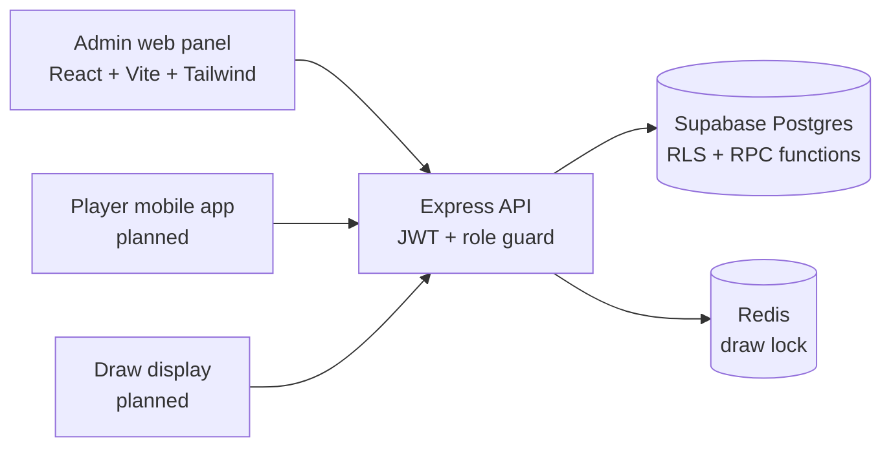

# Lottery Platform

A role-based platform for running lotteries: administrators create lotteries and prizes, players buy tickets with phone-number login, and a draw engine selects the winner with a locked, audited, deterministic process.

**Status:** backend and admin panel working locally; not deployed. Mobile and TV apps are scaffolded only.

<!-- Add 2-3 screenshots of the admin panel here, e.g.  -->

## Features

- **Three roles** — `super_admin`, `admin`, `player` — enforced both in the API (role guard middleware) and in the database (Row Level Security on all six tables).
- **Authentication** — phone OTP for players (via Supabase Auth), email login for admins, JWT-protected routes.
- **Lottery lifecycle** — draft → active → completed / cancelled; multiple ranked prizes per lottery; prize photo upload; prize claim by ticket ID.
- **Transactional ticket purchase** — a Postgres function locks the lottery row (`SELECT ... FOR UPDATE`), then checks status, sold-out state and a 3-tickets-per-player limit before issuing a ticket with a hashed QR value. Concurrent buyers cannot oversell.
- **Draw engine** — Redis `SET NX EX 30` lock prevents duplicate or concurrent draws; tickets are ordered deterministically; the winner is `SHA-256(secret_seed + ticket_count) mod ticket_count`; the result is saved atomically through a Postgres function.
- **Audit log** — every draw attempt (success, forbidden, already running, failure) is written to an `audit_log` table.
- **Admin panel** — React dashboard to create lotteries, add prizes, view tickets and run draws.

## Architecture



| Path | Purpose |
|---|---|
| `apps/api` | Express API: auth, lotteries, tickets, draws, draw engine |
| `apps/web-admin` | React admin panel |
| `apps/mobile`, `apps/tv` | Scaffolds, not yet built |
| `supabase/migrations` | Schema, RLS policies, `purchase_ticket` and `complete_draw` functions |

Monorepo managed with pnpm workspaces and Turborepo.

## Tech stack

Node.js · Express 5 · React · Vite · Tailwind CSS · Supabase (Postgres, Auth, RLS) · Redis (ioredis) · JWT · pnpm · Turborepo

## Run locally

Prerequisites: Node 18+, pnpm, a Supabase project, and a Redis instance.

```bash
pnpm install
# apply the SQL files in supabase/migrations to your Supabase project (Supabase CLI or SQL editor)

cp apps/api/.env.example apps/api/.env              # fill in the values listed below
cp apps/web-admin/.env.example apps/web-admin/.env  # VITE_API_URL (defaults to http://localhost:3000)

pnpm --filter ./apps/api dev          # API on http://localhost:3000
pnpm --filter ./apps/web-admin dev    # admin panel
```

API settings (`apps/api/.env`):

| Variable | Purpose |
|---|---|
| `SUPABASE_URL` | Your Supabase project URL |
| `SUPABASE_SERVICE_ROLE_KEY` | Server-side secret key |
| `JWT_SECRET` | Secret used to sign login tokens |
| `REDIS_URL` | Redis connection (draw lock) |
| `PORT` | Optional, defaults to 3000 |

To create the first admin account, set `SEED_ADMIN_PASSWORD` to a strong password and run `node --env-file=apps/api/.env seed-admin.js`.

**Security note:** never commit `.env` files. The service-role key bypasses row-level security, so it must only ever live on the server.

## Known limitations and roadmap

Being upfront about where this stands:

- **Fairness is partially implemented.** The seed is generated per lottery and its SHA-256 hash (`seed_hash`) is published (the *commit*). The seed itself is not yet revealed after the draw, so players cannot independently verify the result. A public reveal-and-verify endpoint is the next step.
- **The seed is stored in plain text** in the `draws` table and known to the lottery's admin, so this design trusts the operator. A stronger design would use an external randomness beacon or multi-party commitment.
- **No automated tests or CI yet.** Priority: tests for the draw engine and for the RLS policies.
- **Missing API hardening:** rate limiting (especially on OTP), security headers, and restricted CORS.
- **Mobile player app and TV display** are not built.
